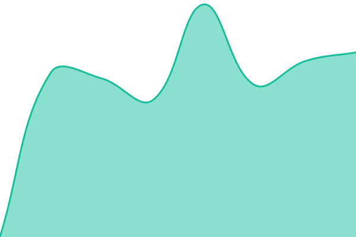
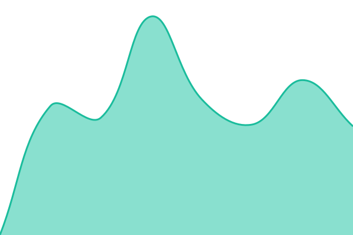
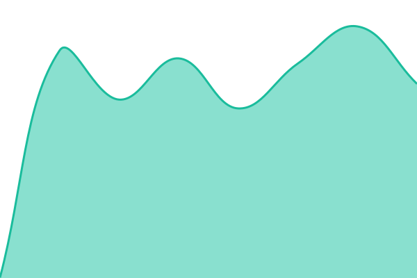
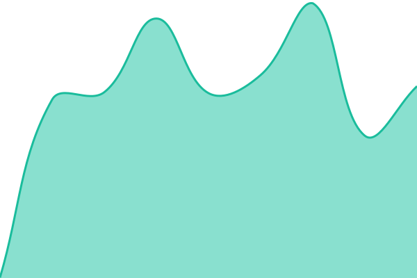
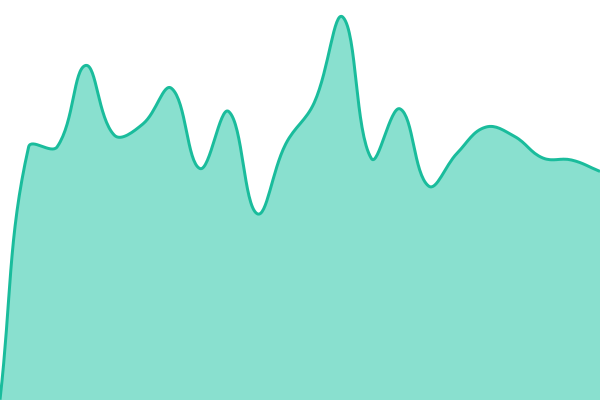
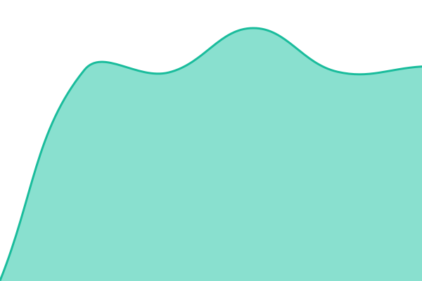

# [📈 Live Status](https://status.econdash.org): <!--live status--> **🟩 All systems operational**

This repository contains the open-source uptime monitor and status page for [Econdash](https://econdash.org/), powered by [Upptime](https://github.com/upptime/upptime).

With [Upptime](https://upptime.js.org), you can get your own unlimited and free uptime monitor and status page, powered entirely by a GitHub repository. We use [Issues](https://github.com/econdash/econdash-status/issues) as incident reports, [Actions](https://github.com/econdash/econdash-status/actions) as uptime monitors, and [Pages](https://status.econdash.org) for the status page.

<!--start: status pages-->
<!-- This summary is generated by Upptime (https://github.com/upptime/upptime) -->
<!-- Do not edit this manually, your changes will be overwritten -->
<!-- prettier-ignore -->
| URL | Status | History | Response Time | Uptime |
| --- | ------ | ------- | ------------- | ------ |
|  [Website](https://econdash.org/) | 🟩 Up | [website.yml](https://github.com/econdash/econdash-status/commits/HEAD/history/website.yml) | 

 889ms
     
 | 

<a href="https://status.econdash.org/history/website">100.00%</a>
    

|  [Explore dashboard](https://econdash.org/explore) | 🟩 Up | [explore-dashboard.yml](https://github.com/econdash/econdash-status/commits/HEAD/history/explore-dashboard.yml) | 

 955ms
     
 | 

<a href="https://status.econdash.org/history/explore-dashboard">100.00%</a>
    

|  [Chart page (data rendered)](https://econdash.org/chart/gdp-nominal/USA) | 🟩 Up | [chart-page-data-rendered.yml](https://github.com/econdash/econdash-status/commits/HEAD/history/chart-page-data-rendered.yml) | 

 1060ms
     
 | 

<a href="https://status.econdash.org/history/chart-page-data-rendered">100.00%</a>
    

|  [Data API](https://econdash.org/api/v1/timeseries/world_bank__gdp_nominal?country=USA&limit=1) | 🟩 Up | [data-api.yml](https://github.com/econdash/econdash-status/commits/HEAD/history/data-api.yml) | 

 454ms
     
 | 

<a href="https://status.econdash.org/history/data-api">100.00%</a>
    

|  [Agent payments (x402/MPP 402)](https://econdash.org/api/v1/m2m/stats) | 🟩 Up | [agent-payments-x402-mpp-402.yml](https://github.com/econdash/econdash-status/commits/HEAD/history/agent-payments-x402-mpp-402.yml) | 

 463ms
     
 | 

<a href="https://status.econdash.org/history/agent-payments-x402-mpp-402">100.00%</a>
    

|  [llms.txt](https://econdash.org/llms.txt) | 🟩 Up | [llms-txt.yml](https://github.com/econdash/econdash-status/commits/HEAD/history/llms-txt.yml) | 

 539ms
     
 | 

<a href="https://status.econdash.org/history/llms-txt">100.00%</a>
    

|  [Sitemap](https://econdash.org/sitemap.xml) | 🟩 Up | [sitemap.yml](https://github.com/econdash/econdash-status/commits/HEAD/history/sitemap.yml) | 

 988ms
     
 | 

<a href="https://status.econdash.org/history/sitemap">100.00%</a>
    

|  [Data updates feed](https://econdash.org/feeds/updates.xml) | 🟩 Up | [data-updates-feed.yml](https://github.com/econdash/econdash-status/commits/HEAD/history/data-updates-feed.yml) | 

 893ms
     
 | 

<a href="https://status.econdash.org/history/data-updates-feed">100.00%</a>
    

|  [OpenAPI spec](https://econdash.org/openapi.json) | 🟩 Up | [open-api-spec.yml](https://github.com/econdash/econdash-status/commits/HEAD/history/open-api-spec.yml) | 

 712ms
     
 | 

<a href="https://status.econdash.org/history/open-api-spec">100.00%</a>
    

<!--end: status pages-->

[**Visit our status website →**](https://status.econdash.org)

## 📄 License

- Powered by: [Upptime](https://github.com/upptime/upptime)
- Code: [MIT](./LICENSE) © [Anand Chowdhary](https://anandchowdhary.com)
- Data in the `./history` directory: [Open Database License](https://opendatacommons.org/licenses/odbl/1-0/)
